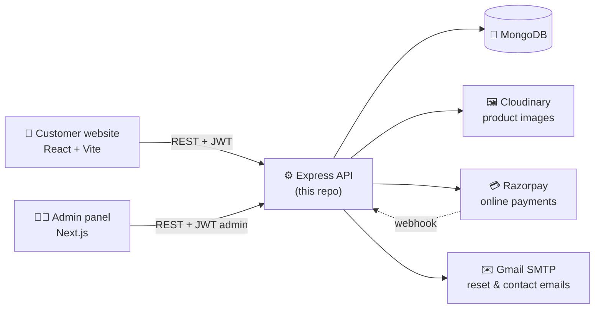
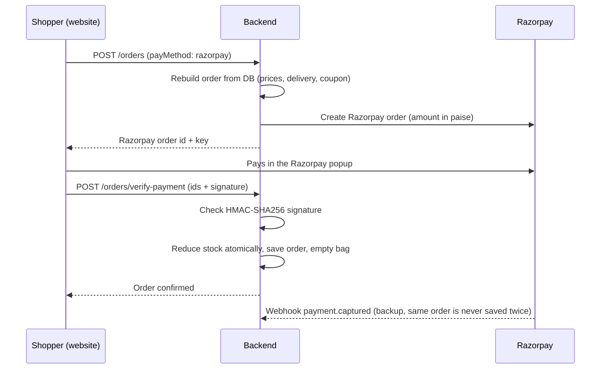

<div align="center">

# 🛍️ Fashion Bazar — Backend API

**REST API powering the Fashion Bazar store and admin panel**
Products · bag · checkout with Razorpay & cash on delivery · orders, cancellations & returns · coupons · reviews · admin analytics


</div>

---

## 📦 The Fashion Bazar project

Fashion Bazar is a full-stack fashion e-commerce platform split into three repositories:

| Repository | What it is | Stack |
|---|---|---|
| **[fashion_bazar](https://github.com/prajapathiAjay/fashion_bazar)** | Customer website | React 19 · Vite · Redux Toolkit · Tailwind |
| **[fashion_bazzar_admin_panel](https://github.com/prajapathiAjay/fashion_bazzar_admin_panel)** | Admin panel | Next.js 16 · Redux Toolkit · Tailwind |
| **fashion_bazar_backend** *(this repo)* | REST API | Node.js · Express · MongoDB |



---

## ✨ Features

**Shopping**
- Product catalogue with **search, category, size, price filters, sorting and pagination**, all done in one MongoDB aggregation
- **Bag per product + size**: adding the same size again increases the quantity; stock, sizes and hidden products are checked on every add
- **Wishlist**, one save per shopper per product (unique index)
- **Reviews** with automatic rating average and count, admin replies and moderation

**Checkout & payments**
- **The server recalculates every order**: sale prices, delivery fee and coupon come from the database, never from the browser
- **Cash on delivery** and **Razorpay**: the order is created only after the payment signature (HMAC-SHA256) is verified
- **Razorpay webhook** as a backup when the shopper closes the tab, verified against the raw request body; a unique index stops duplicate orders
- **Atomic stock control**: stock can't go below zero, and is put back if anything fails
- **Coupons**: percentage or flat, minimum order, maximum discount, usage limit, once-per-customer, start and end dates (Indian time)

**After the order**
- Order life cycle `Ordered → Packed → Shipped → Delivered`
- **Customer cancellation** before shipping: stock and coupon use go back, online payments are refunded automatically
- **Returns** within 30 days of delivery: `Requested → Approved → Received → Refunded` (or `Rejected`), with stock restored once and automatic Razorpay refunds
- **Refund recovery**: if Razorpay refuses a refund, the admin can retry it or record a manual refund

**Accounts & security**
- JWT login (shoppers 7 days, admins 1 day); passwords hashed with **bcrypt**
- **Forgot password** by email: hashed single-use token, valid for 15 minutes
- Changing the password signs out older sessions
- Role-based access: every `/api/admin/*` route needs `jwtAuth` + `isAdmin`
- CORS allowlist; input validation in controllers and schemas; consistent JSON errors (`{ success, message }`)

**Admin**
- Dashboard and analytics computed from real orders: gross sales, average order value, returning customers, cancellation rate, sales by category, top products, regions, heatmap
- Products, categories, coupons, delivery options, reviews, contact messages, FAQs and store settings
- Image upload to **Cloudinary**

---

## 🧱 Tech stack

| Area | Tools |
|---|---|
| Runtime | Node.js 20+, Express 4 (ES modules) |
| Database | MongoDB with Mongoose 7 |
| Auth | jsonwebtoken, bcrypt |
| Payments | Razorpay (orders, signature check, refunds, webhook) |
| Images | Cloudinary + multer (in-memory upload) |
| Email | Nodemailer (Gmail SMTP) |

---

## 📁 Folder structure

Every feature has the same four layers: **routes → controller → repository → schema**.

```
backend/
├── server.js                 App setup: CORS, JSON, routes, error handler
├── scripts/seedFaqs.js       Seeds the starter FAQs
└── src/
    ├── config/               MongoDB, JWT secret check, Cloudinary, Razorpay, Nodemailer
    ├── middlewares/          jwtAuth, isAdmin, request logger
    ├── error-handler/        ApplicationError (message + HTTP status)
    ├── helper/               buildOrderData (prices on the server), email templates
    └── features/
        ├── product/          catalogue, filters, search
        ├── category/
        ├── cartItems/        bag
        ├── wishlist/
        ├── order/            checkout, Razorpay, cancel, returns, refunds, webhook
        ├── discount/         coupons
        ├── shipping/         delivery options and prices
        ├── review/
        ├── user/             sign-up, login, profile, addresses, password reset, admin customers
        ├── contact/          contact form + newsletter
        ├── faq/
        ├── settings/         store name and contact details
        ├── stats/            dashboard and analytics numbers
        └── upload/           Cloudinary uploads
```

---

## 🔌 API reference

Base URL: `/api`. 🔒 = login required (`Authorization: Bearer <token>`), 🛡️ = admin only.

<details>
<summary><b>Auth & profile</b></summary>

| Method | Path | Access | Description |
|---|---|---|---|
| POST | `/users/signup` | Public | Create a shopper account |
| POST | `/users/signin` | Public | Log in, returns a JWT |
| POST | `/users/admin/signin` | Public | Admin log in |
| POST | `/users/forgot-password` | Public | Email a reset link |
| POST | `/users/reset-password` | Public | Set a new password from the link |
| PUT | `/users/resetPassword` | 🔒 | Change password (needs the current one) |
| GET | `/users` | 🔒 | My profile |
| POST | `/users/update-user` | 🔒 | Update profile and addresses |
</details>

<details>
<summary><b>Catalogue</b></summary>

| Method | Path | Access | Description |
|---|---|---|---|
| GET | `/products` | Public | List with `q, category, size, maxPrice, onSale, sort, page, limit` |
| GET | `/products/filter-options` | Public | Sizes and highest price that exist |
| GET | `/products/:id` | Public | One product |
| POST · PATCH · DELETE | `/products`, `/products/:id` | 🛡️ | Manage products |
| GET | `/category`, `/category/:id` | Public | Categories (active only for shoppers) |
| POST · PATCH · DELETE | `/category`, `/category/:id` | 🛡️ | Manage categories |
| GET · POST | `/review/:productId`, `/review` | Public · 🔒 | Read / write reviews |
</details>

<details>
<summary><b>Bag, wishlist & checkout</b></summary>

| Method | Path | Access | Description |
|---|---|---|---|
| GET · POST | `/cartItems` | 🔒 | My bag / add (product, size, quantity) |
| PATCH · DELETE | `/cartItems/:id` | 🔒 | Change quantity or size / remove |
| GET · POST · DELETE | `/wishlist`, `/wishlist/:id` | 🔒 | Wishlist |
| GET | `/shipping` | Public | Delivery options and prices |
| POST | `/discounts/apply` | 🔒 | Check a coupon against my bag |
| POST | `/orders` | 🔒 | Place order (COD) or start a Razorpay payment |
| POST | `/orders/verify-payment` | 🔒 | Verify the Razorpay signature and create the order |
| GET | `/orders` | 🔒 | My orders |
| POST | `/orders/:id/cancel` | 🔒 | Cancel before shipping |
| POST | `/orders/:id/return` | 🔒 | Request a return (30 days) |
| POST | `/razorpay/webhook` | Razorpay signature | Payment captured backup |
</details>

<details>
<summary><b>Admin</b> 🛡️</summary>

| Method | Path | Description |
|---|---|---|
| GET | `/admin/orders`, `/admin/orders/:id` | All orders / one order |
| PATCH | `/admin/orders/:id/status` | Packed, Shipped, Delivered or Cancelled |
| PATCH | `/admin/orders/:id/return` | `approve`, `reject`, `receive`, `refunded` |
| PATCH | `/admin/orders/:id/refund` | Retry or record a refund on a cancelled order |
| GET | `/admin/customers`, `/admin/customers/:id` | Customers with orders and spend |
| CRUD | `/admin/discounts` | Coupons |
| CRUD | `/admin/shipping` | Delivery options |
| GET · PATCH · DELETE | `/admin/reviews` | Moderate and reply |
| GET · PATCH · DELETE | `/admin/messages` | Contact form inbox |
| CRUD | `/admin/faqs` | Help centre |
| GET · PATCH | `/admin/settings` | Store details |
| GET | `/admin/stats/dashboard`, `/admin/stats/analytics` | `?range=7d \| 30d \| 12m` |
| POST · GET | `/upload`, `/upload/signature` | Image upload to Cloudinary |
</details>

<details>
<summary><b>Public info</b></summary>

| Method | Path | Description |
|---|---|---|
| GET | `/settings` | Store name and contact details |
| GET | `/faq` | Published FAQs |
| POST | `/contact`, `/contact/subscribe` | Contact form, newsletter |
</details>

### How an online payment works



---

## 🚀 Getting started

### Requirements
- Node.js 20 or newer
- MongoDB (local, or a free MongoDB Atlas cluster)
- Free accounts on Cloudinary and Razorpay (test mode), and a Gmail **App Password** for emails

### Install and run
```bash
git clone https://github.com/prajapathiAjay/fashion_bazar_backend.git
cd fashion_bazar_backend/backend
npm install
# create the .env file (see below), then:
npm run dev        # development, restarts on changes
npm start          # production
```
The API runs on **http://localhost:3200**. Required settings are checked at start-up, and the server lists anything missing.

### Environment variables
Create `backend/.env`. **Never commit it** (it's already in `.gitignore`).

| Variable | Required | Description |
|---|---|---|
| `PORT` | No | Port to listen on (default `3200`; hosts set it for you) |
| `DB_URL` | ✅ | MongoDB connection string |
| `JWT_SECRET` | ✅ | Long random string used to sign logins (32+ characters) |
| `ALLOWED_ORIGINS` | ✅ | Website and admin URLs allowed by CORS, comma separated |
| `CLIENT_URL` | ✅ | Website URL, used in password-reset emails |
| `CLOUDINARY_CLOUD_NAME` | ✅ | Cloudinary account |
| `CLOUDINARY_API_KEY` | ✅ | Cloudinary API key |
| `CLOUDINARY_API_SECRET` | ✅ | Cloudinary API secret |
| `RAZORPAY_KEY_ID` | ✅ | Razorpay key id (`rzp_test_…` for testing) |
| `RAZORPAY_KEY_SECRET` | ✅ | Razorpay key secret |
| `RAZORPAY_WEBHOOK_SECRET` | Optional | Secret set on the Razorpay webhook |
| `GMAIL` | ✅ | Gmail address that sends emails |
| `APP_Password` | ✅ | Gmail App Password (not your normal password) |
| `CONTACT_NOTIFY_EMAIL` | Optional | Where contact-form messages go (defaults to `GMAIL`) |

### Create an admin
There's no public admin sign-up, on purpose. Sign up on the website, then in MongoDB change that user's `type` from `"user"` to `"admin"`.

---

## ☁️ Deployment (Render)

1. Create a **Web Service** from this repo with root directory `backend`.
2. Build command `npm install`, start command `npm start`.
3. Add the environment variables above in **Environment**, with `ALLOWED_ORIGINS` and `CLIENT_URL` set to the live website and admin URLs.
4. Optional: add a Razorpay webhook to `https://<your-api>/api/razorpay/webhook` (event `payment.captured`).

> On Render's free plan the service sleeps after 15 minutes without traffic, so the first request afterwards takes about 30–50 seconds.

---

## 👤 Author

**Ajay Prajapathi** · [GitHub @prajapathiAjay](https://github.com/prajapathiAjay)
